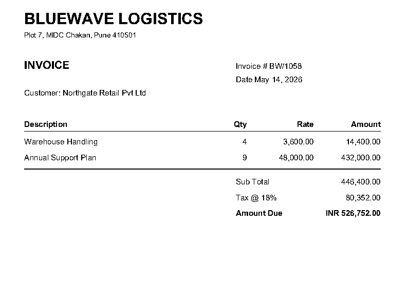

# PDF Invoice Extractor (Python)

Reads a folder of PDF invoices from different vendors, pulls the key fields into one Excel workbook, and flags anything that needs a human to look at it.


---

## The Problem

Accounts payable teams receive invoices as PDFs. Someone opens each one and types the invoice number, date and amounts into a spreadsheet or ERP. It is slow, typing errors creep in, and the same invoice sent twice can easily be paid twice.

Every vendor also lays out the invoice differently: one writes `Invoice No`, another `Invoice #`, a third `Bill Number`; the total is `Grand Total`, `Amount Due` or `Total Payable`.

## The Solution

```bash
python extract_invoices.py sample-invoices
```

For every PDF in the folder, the script:

1. Reads the text of the PDF
2. Finds each field by trying a list of wordings in turn
3. Converts dates (five formats) and amounts to real values
4. Checks the result: required fields present, **subtotal + tax = total**, no duplicate invoice numbers
5. Writes an Excel workbook with an **Invoices** sheet and an **Issues** sheet

| From this (one of three layouts) | To this |
|---|---|
|  | One row: `Bluewave Logistics`, `BW/1058`, `14-May-2026`, `446,400.00`, `80,352.00`, `526,752.00`, `OK` |

## Sample Run

The `sample-invoices` folder holds 14 PDFs from three made-up vendors, with three problems planted on purpose.

```
PDFs read:      14
Extracted OK:   11   (total value 2,469,740.00)
Need checking:  3
  ! apex_delivery_note.pdf: Does not look like an invoice (no invoice number or total found)
  ! bluewave_BW-1059.pdf: Total 195,641.00 does not equal subtotal + tax 194,641.00
  ! crestline_CR-88214_resent.pdf: Duplicate of crestline_CR-88214.pdf (same vendor and invoice number)
Time taken:     1.1 sec
```

| File | Vendor | Invoice Number | Invoice Date | Subtotal | Tax | Total | Status |
|---|---|---|---|---|---|---|---|
| apex_AOS-2026-0141.pdf | Apex Office Supplies | AOS-2026-0141 | 12-Jun-2026 | 462,900.00 | 83,322.00 | 546,222.00 | OK |
| bluewave_BW-1059.pdf | Bluewave Logistics | BW/1059 | 16-Jun-2026 | 164,950.00 | 29,691.00 | 195,641.00 | Check |
| crestline_CR-88213.pdf | Crestline IT Services LLP | CR-88213 | 23-May-2026 | 320,500.00 | 57,690.00 | 378,190.00 | OK |

## Features

| Feature | Details |
|---|---|
| 🧾 Multiple layouts | Each field has a list of patterns; three vendor layouts work out of the box |
| 📅 Date and amount parsing | `14/05/2026`, `2026-05-20`, `May 14, 2026`; `Rs 14,750.00`, `INR 23,600.00` |
| ✅ Arithmetic check | Flags invoices where subtotal + tax does not equal the total (with a rounding tolerance) |
| 🔁 Duplicate detection | Same vendor and invoice number in two files |
| 🚫 Non-invoices | Delivery notes and other PDFs are reported, not silently skipped |
| 🛡️ Never stops halfway | A damaged or scanned PDF is logged as an issue and the run continues |
| 📊 Excel output | Formatted workbook with status colours, ready to filter |

## How to Use

```bash
pip install -r requirements.txt
```

```bash
python extract_invoices.py "C:/Invoices/May" --output May_Invoices.xlsx
```

**Adding a new vendor layout:** open `extract_invoices.py` and add a pattern to `FIELD_PATTERNS`. For example, if a vendor writes `Ref No: 12345`:

```python
"invoice_number": [
    r"Invoice\s*(?:No\.?|Number|#)\s*:?\s*([A-Z0-9][A-Z0-9/\-]+)",
    r"Bill\s*(?:No\.?|Number)\s*:?\s*([A-Z0-9][A-Z0-9/\-]+)",
    r"Ref\s*No\.?\s*:?\s*([A-Z0-9][A-Z0-9/\-]+)",        # new
],
```

Run the tests:

```bash
python -m pytest
```

## Limitations

- Works on PDFs that contain text. **Scanned images need OCR first** (the script tells you when a PDF has no readable text).
- Extracts header fields, not individual line items.

## Project Structure

```
python-pdf-invoice-extractor/
├── extract_invoices.py         # the extractor
├── make_sample_invoices.py     # recreates the sample PDFs (fixed seed)
├── sample-invoices/            # 14 sample PDFs, 3 layouts
├── tests/
│   └── test_extract.py
├── images/                     # picture for this README
├── requirements.txt
├── README.md
└── LICENSE
```

## Roadmap

- [ ] Line-item extraction using table detection
- [ ] OCR fallback for scanned invoices
- [ ] Vendor patterns in a config file instead of the script

---

**Author:** [Swaminathan Narayanan](https://www.linkedin.com/in/swaminathan-narayanan-9781a7154/): Data Analytics | Excel & VBA Automation | Python | SQL | Power BI
